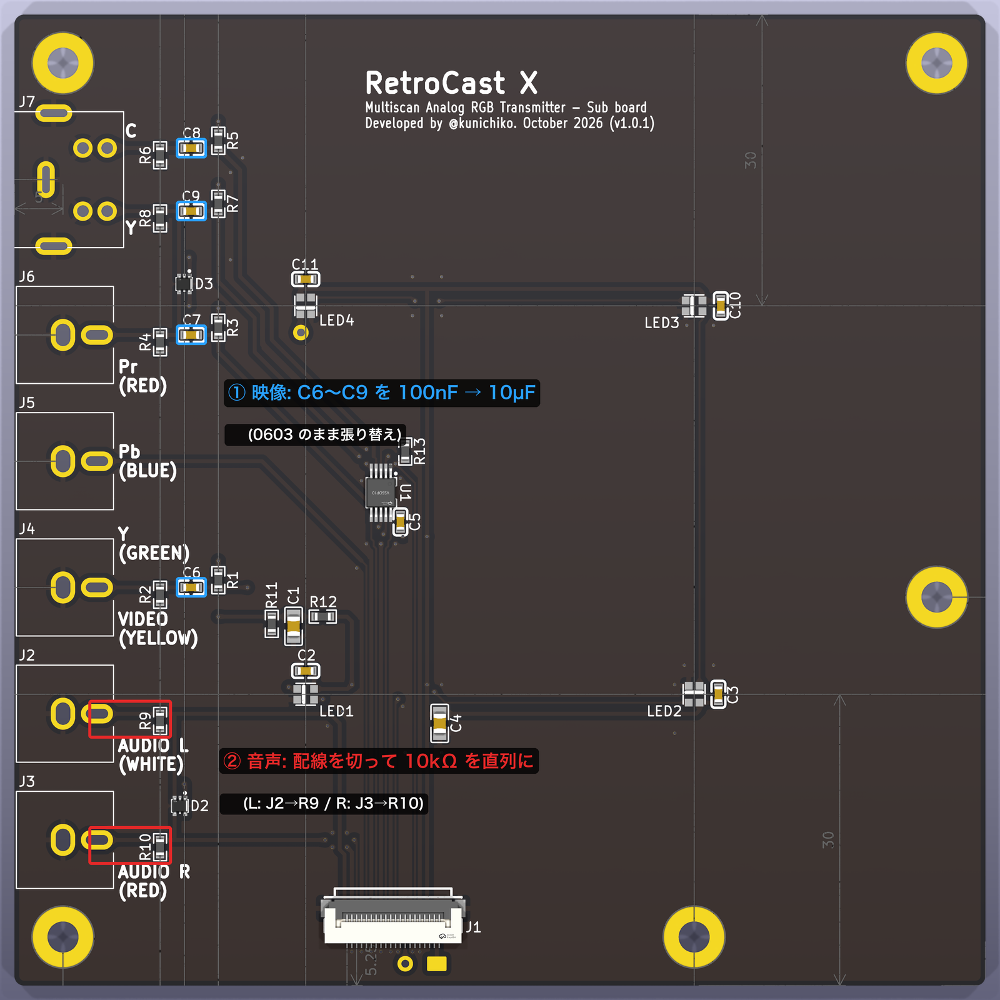
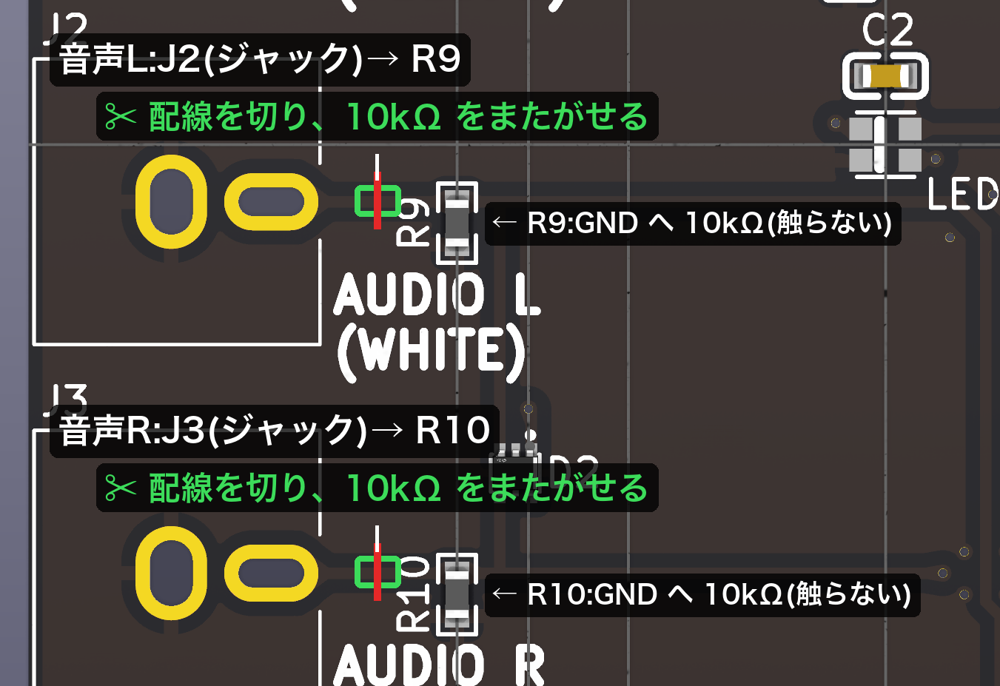

# 小亀基板 v1.0.1 の改修(パッチ)箇所

発注済みの **v1.0.1**(シルクに `(v1.0.1)` とある基板)を、いまの設計(`main.ato`)に
合わせるための手作業の改修。どちらも v1.0.1 を発注した後に実機で見つかったもので、
設計側は 2026-11-08 に直してある(次に発注する版には入る)。

| # | 対象 | 症状 | 作業 | 設計側の修正 |
|---|---|---|---|---|
| ① | 映像の結合コンデンサ C6〜C9 | 明るい区間の後ろで黒が 7〜9 コード沈む | 0603 の 100nF → **10µF** に張り替え | `ea37563` |
| ② | 音声 L/R(J2・J3) | ゲーム中の大きな音で**音が割れる** | 配線を1か所ずつ切り、**10kΩ を直列に** | `eef66c8` |



> 図は v1.0.1 の基板データ(`v1.0.1-pcb` タグ)を KiCad で上面から描いたもの。
> RCA ジャックの本体は描かれていない(白枠がジャックの外形、黄色が足のランド)。

## ① 映像: C6〜C9 を 10µF に張り替える

| 部品 | 信号 | v1.0.1 の実装 | 張り替え後 |
|---|---|---|---|
| C6 | コンポジット(黄)/ Y | 100nF | **10µF** |
| C7 | Pr(赤) | 100nF | **10µF** |
| C8 | S端子 C | 100nF | **10µF** |
| C9 | S端子 Y | 100nF | **10µF** |

- 部品は 0603(1608)の 10µF。発注版では LCSC **C19702**(Samsung CL10A106KP8NNNC)。
  パッドは同じなので、外して載せ替えるだけ。
- 理由: 75Ω 終端 → 100nF → 10kΩ(1.65V へバイアス)は時定数 1ms の高域通過で、
  明るい区間の後ろで黒が沈む(コンポーネントで実測)。10µF で 0.1 秒になり消える。
  詳しくは [README](../README.md) の「75Ω終端と中点バイアス」。
- C8(S端子 C)は低域を持たないので 100nF のままでも困らないが、揃えておく。

**済んでいるかの見分け方**: 見た目では区別しにくい。テスターの容量レンジで
C6 を当てる(実装したままだと周りの抵抗の影響を受けるが、100nF と 10µF は桁が
2つ違うので判別できる)。または白と黒が交互に並ぶ画面で、白の右側の黒が沈まないか見る。

## ② 音声: 配線を切って 10kΩ を直列に入れる



### なぜ要るか

PCM1808 が受けられるのは **3Vpp** まで(VCC=5V)。民生機のライン出力は最大
**2Vrms(5.66Vpp)** 出る。v1.0.1 はジャックを ADC に直結していて(R9/R10 で
GND へ 10kΩ 落としているだけ)、PS2 の音が入りきらない。

2026-11-23 の実測(PS2「ぷよぷよ」のプレイ中、ボードから届いた生の値を2分):
L は **4384 か所**、R は 1630 か所で上限 +32767 に張り付いていた(最長 51 サンプル
≒ 1ms の平らな頭)。ロビー画面の小さい音(ピーク −1.1dBFS)では張り付かないので、
大きな音のときだけ割れる。**ADC の手前で切れているので、Viewer の音量では直せない。**

### 回路(L/R とも同じ)

```
v1.0.1(いま)                          改修後(= いまの設計)

J2 ジャック ──────┬──→ FFC 20(L)        J2 ジャック ─[10kΩ 追加]─┬──→ FFC 20(L)
                  R9 10kΩ                                          R9 10kΩ
                  │                                                │
                 GND                                              GND
```

ADC の入力インピーダンス 60kΩ を含めて **0.46 倍**(10k‖60k ÷ (10k + 10k‖60k))。
2Vrms が 2.6Vpp になり、上限まで 1.3dB 残る。送り出しから見た負荷は約 18.6kΩ
(民生機のライン出力は 10kΩ 以上を想定しているので問題ない)。

### 手順

| ch | 切る配線 | 追加する抵抗 | 触らない部品 |
|---|---|---|---|
| L(白) | **J2 の右側のランド → R9 の上側のパッド**(表面、0.4mm 幅、約 5mm) | 10kΩ | R9 |
| R(赤) | **J3 の右側のランド → R10 の上側のパッド**(同上) | 10kΩ | R10 |

1. 配線の中ほど(ジャックの外形の白枠と R9/R10 の間)をカッターで2本切り込み、
   間の銅を剥がして **0.5mm ほど**の隙間を作る。
2. 隙間の両側のレジストを少し削って銅を出し、予備はんだをする。
3. **1608(0603)の 10kΩ** を隙間をまたいで載せる(1/16W で十分。流れる電流は
   1mA にも届かない)。リード付きの抵抗で、ジャックの足と R9/R10 の上側のパッドを
   結んでもよい。
4. **R9/R10 は外さない。** これが分圧の GND 側になる。

★切る位置は**ジャックと R9/R10 の間**であること。R9/R10 より FFC 側(右や下)で
切ると、R9/R10 が ADC から切り離されて分圧にならない。

### 確かめ方

FFC を外した状態でテスターを当てる。

| 測る所 | 改修前 | 改修後 |
|---|---|---|
| J2(J3)の信号の足 ↔ GND | 10kΩ | **20kΩ** |
| J2(J3)の信号の足 ↔ R9(R10)の上側のパッド | 0Ω | **10kΩ** |
| R9(R10)の上側のパッド ↔ GND | 10kΩ | **10kΩ**(変わらない) |

★3行目は**作業中に R9/R10 を壊していないか**の確認。すぐ隣ではんだごてを当てるので、
熱や力で割れたり外れたりしやすい。R9/R10 が開放だと分圧の GND 側が ADC の入力
(約 60kΩ)だけになり、0.86 倍(−1.3dB)にしかならない。音は普通に出るので、
**聞いただけでは気づけない**(実際にこれで割れが直らなかった)。

#### うまくいかないとき

上の2つは 2026-11-24 の改修で実際に起きた。

| 症状 | 原因 | 測ると |
|---|---|---|
| 音が出なくなった | 追加した 10kΩ の片側が付いていない(切った配線のレジストの削り不足) | 信号の足 ↔ R9 の上側のパッドが開放 |
| 音は出るが、片方だけ割れが直らない | その ch の R9/R10 が割れて開放 | R9 の上側のパッド ↔ GND が開放 |
| 音は出るが、まったく小さくならない(起こりうる) | 切った隙間をはんだが埋めて 10kΩ がショート | 信号の足 ↔ R9 の上側のパッドがほぼ 0Ω |

改修後は音が約 −6.7dB 小さくなる。Viewer の音量(150% まで)で補う。

#### 音で確かめる

遊びながら録るなら、Viewer を `RCX_AUDIO_DUMP=パス` を付けて起動する
(WAV に書き出される。詳しくは [Viewer の README](../../../client/README.md) の「音声を録る」)。
数秒だけでよければ、Viewer を閉じて
`python3 -m retrocastx.audio_dump --source 3 --seconds 15`(`host/python` で実行)。

ゲーム中の大きな音で ±32767 に張り付かなければよい。L と R の大きさが改修前と同じ
割合で下がっているか(どちらも約 −6.7dB)も見ると、片側だけ効いていないのに気づける。
2026-11-24 の改修後の実測(ぷよぷよのプレイ中 2 分)は、ピーク L −3.6dBFS / R −4.0dBFS、
張り付きなし。
